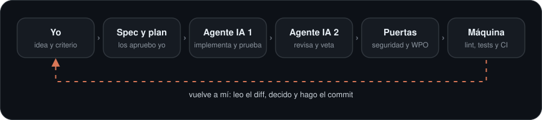

<p align="center">
  
</p>

## Quién soy

Pasé mas de diez años soldando en talleres del metal. Hoy trabajo como **software developer** y estoy creciendo hacia **AI engineer**.

Hice yo **toolsequip.es**, una web en producción que sigo manteniendo. Y estoy desarrollando desde cero **Pivoa**, la app interna de Recambios del Primer Equipo, con asistente de voz y chatbot, pensada para poder llevarla a más tiendas del grupo.

Me gusta el código que se entiende a la primera, también el que escribe la IA. Si no lo entiendo, no entra.

---

## Cómo trabajo con IA

Uso agentes de IA para programar, pero el código tiene que poder leerlo y cambiarlo yo sin ayuda. Para eso tengo montado un **arnés propio** en el que **dos agentes de IA trabajan a la par**: uno implementa y el otro revisa. El método no depende de la herramienta: funciona con cualquier agente. Cada uno tiene su papel, la máquina vigila lo que se puede comprobar y la última palabra es mía.

### Los bloques del método

| # | Bloque | Cómo lo aplico |
|---|---|---|
| 1 | **Fundamentos: LLMs, modelos y herramientas** | Un modelo solo ve su contexto y puede equivocarse con seguridad: lo que importa va en el contexto y lo que dice se comprueba fuera. Elijo modelo y esfuerzo según la tarea, con la skill `choose-model`. |
| 2 | **Arnés: agente, guardarraíles y contexto** | Un `AGENTS.md` corto como única fuente de reglas, memoria del proyecto de pocas líneas, permisos que impiden a los agentes tocar secretos y git, y un hook previo al push que ejecuta todas las pruebas. Lo que importa se impide, no se pide. |
| 3 | **Arnés avanzado: skills y MCPs** | Una skill por cada procedimiento que repito, y un MCP solo si resuelve un problema que ya tuve. Cada herramienta cuesta contexto y abre superficie de ataque. |
| 4 | **Spec-Driven Development** | Spec, plan, tareas, una tarea cada vez y revisión requisito a requisito. Un requisito no se da por hecho hasta que su prueba se ha ejecutado. |
| 5 | **Multiagente y subagentes** | Quien escribe y quien revisa son distintos, a veces incluso otro modelo. Cada subagente recibe un solo encargo con el contexto limpio. |
| 6 | **Personalización de sistemas** | La norma de estilo, el flujo y los roles viven en mis [plugins](#herramientas-que-publico) y los usa cualquier proyecto, en lugar de repetir prompts. |
| 7 | **Construir con LLMs** | Medir en lugar de mirar: casos con resultado esperado, línea base, coste y duración, y pruebas de ataque. En preparación sobre el asistente de voz. |

**Siempre con control y criterio.** Antes de cada commit leo el diff entero, lo explico en dos frases sin abrir el chat y digo qué prueba fallaría si estuviera mal. Si no lo entiendo, no entra.

<p align="center">
  
</p>

### Quién hace qué

| Paso | Quién | Qué hace |
|---|---|---|
| Idea y prioridad | Yo | Decido qué se construye y en qué orden. |
| Spec, plan y tareas | Agente planificador | Escribe los requisitos en formato EARS, el plan y las tareas. Un agente revisor los repasa como QA, y yo los apruebo antes de que se toque una línea. |
| Implementación | Agente de IA 1 | Una sola tarea cada vez, con la prueba primero. Nunca hace commit. |
| Revisión técnica | Agente de IA 2 | Revisa el diff real como ingeniero líder y puede vetarlo. Ejecuta las pruebas y comprueba cada requisito; no se fía del resumen de quien implementa. |
| Puertas | Agentes con derecho de veto | Uno para la seguridad del backend y otro para el rendimiento de la web. Vetar es parar y explicar, nunca deshacer. |
| Versión final | Yo | Leo el diff, decido y hago el commit. Git es solo mío: ningún agente puede hacer `add`, `commit` ni `push`. |

<details>
<summary><b>Los revisores, uno por tema</b></summary>

<br>

- **Norma de estilo** (`conventions-reviewer`): capas separadas, sin `else` ni `switch`, tablas en lugar de cadenas de `if`, nombres con sentido y funciones cortas.
- **Oficio** (`craft-reviewer`): SOLID, Clean Code, Ousterhout y McConnell, en cualquier lenguaje.
- **Seguridad** (`backend-reviewer` y `devsecops-gate`): OWASP, sesiones, contraseñas, enlaces de un solo uso y aislamiento entre clientes. Cada regla cita el requisito de la spec que la exige, para que vete por lo pactado y no por gusto.
- **Rendimiento** (`wpo-gate`): presupuesto de JavaScript por página, imágenes y rutas.
- **Diseño** (`design-reviewer`): tokens del sistema de diseño, accesibilidad WCAG AA y reglas de contenido.
- **Spec** (`reviewer`): valida la implementación requisito por requisito.

</details>

<details>
<summary><b>Lo que vigila la máquina</b></summary>

<br>

Lo que se puede comprobar no depende de la memoria de nadie:

- **Linters con mi norma:** Ruff en Python y oxlint en JavaScript.
- **Pruebas que leen el código:** sin `else`, sin `switch` ni `match`, errores solo en `attempt()`, funciones de 20 líneas y 3 parámetros como máximo.
- **Un trinquete para las reglas nuevas** (sin ternarios, un solo nivel de bloques, sin parámetros booleanos y sin mutar): el código antiguo conserva su recuento, ningún archivo puede tener más y, cuando arreglo uno, el número solo baja. Lo nuevo nace limpio sin reescribir lo que ya funcionaba.
- **CI en cada pull request:** pytest, Vitest, build con presupuesto de JavaScript, migraciones arriba, abajo y arriba otra vez contra PostgreSQL, y auditoría de dependencias.

</details>

### Cómo reviso yo

<p align="center">
  
</p>

> **Gracias a [readfirst](https://github.com/fernando-delrio/readfirst), mi skill de escritura de código, leo el código más rápido y lo entiendo a la primera.** Todo el código que entra tiene la misma forma, lo escriba el agente que lo escriba: funciones cortas, guardas arriba, tablas en lugar de cadenas de `if` y errores en un solo sitio. Sé qué me voy a encontrar antes de abrir el archivo.

No es que lea más deprisa: es que todo está preparado para poder leerse.

1. **Cada entrega llega con el mismo resumen:** archivos tocados con una línea cada uno, qué funciona ahora que antes no, lo siguiente pendiente y los comandos de commit con las rutas exactas. Sé qué ha cambiado y por qué antes de abrir un archivo.
2. **Cambios pequeños:** un commit por incremento, que deja el sistema funcionando. Si pasa de 100 líneas, se divide o se explica por qué no.
3. **Leo el diff en orden de riesgo:** primero los textos que verá un cliente, después las pruebas y la documentación, y al final el código. Un test rebajado puede esconder un fallo con todo en verde; me ha pasado, y por eso miro primero ahí.
4. **El código se lee de arriba abajo gracias a [readfirst](https://github.com/fernando-delrio/readfirst)**, mi skill de escritura de código, que cualquier agente sigue. Esto es lo que me deja leer rápido:
   - **Funciones cortas**, de 20 líneas como máximo, con un nombre verbo + objeto que dice lo que hacen.
   - **Guardas arriba** (`if (…) return`) y un solo nivel de bloques: no hay que llevar la cuenta de en qué rama estás.
   - **Tablas en lugar de cadenas de `if`**: lo que cambia según un valor se lee en una sola mirada.
   - **Cada capa hace una cosa:** el componente pinta, el hook orquesta y el servicio llama a la API. Sé en qué archivo buscar antes de abrirlo.
   - **Los errores, en un solo sitio** (`attempt()`): no hay `try/catch` repartidos que seguir.

   Si un trozo no se puede leer así, la revisión lo devuelve.
5. **Una pregunta antes de darlo por bueno:** ¿lo pondría delante del cliente ahora mismo, sin avisar de nada? Si la respuesta es «sí, pero…», no está terminado.
6. **Desconfío de lo que está en verde:** una comprobación que nunca salta puede estar rota. Por eso las pongo a prueba metiendo una infracción a propósito. Así descubrí dos agentes revisores que no llegaban a cargarse y no daban ningún error.

### Lo que cambia readfirst

La misma función, con el mismo resultado. A la izquierda, como la escribe una IA sin norma; a la derecha, como tiene que escribirla conmigo:

<table>
<tr>
<th align="left">Sin norma</th>
<th align="left">Con <a href="https://github.com/fernando-delrio/readfirst">readfirst</a></th>
</tr>
<tr>
<td valign="top">

```ts
function getDiscount(customer) {
  if (customer.tier === 'gold') {
    return 0.2
  } else if (customer.tier === 'silver') {
    return 0.1
  } else {
    return customer.isNew ? 0.05 : 0
  }
}
```

</td>
<td valign="top">

```ts
const DISCOUNTS = { gold: 0.2, silver: 0.1 }
const WELCOME_DISCOUNT = 0.05
const NO_DISCOUNT = 0

export const discountFor = (customer) => {
  const rate = DISCOUNTS[customer.tier]
  if (rate) return rate
  if (customer.isNew) return WELCOME_DISCOUNT
  return NO_DISCOUNT
}
```

</td>
</tr>
</table>

A la derecha se lee de arriba abajo: primero el descuento de la categoría y después el de cliente nuevo, cada número tiene nombre y no hay ramas que seguir. Añadir una categoría es una línea en la tabla.

---

## Ruta de AI engineer

Mi ruta de estudio, con estado y entregable por bloque y contrastada con el [roadmap de AI Engineer de roadmap.sh](https://roadmap.sh/ai-engineer): [ruta-ai-engineer/](./ruta-ai-engineer/).

## Herramientas que publico

Tres plugins de Claude Code, cada uno con su repositorio y su instalación:

| Repositorio | Para qué sirve |
|---|---|
| [readfirst](https://github.com/fernando-delrio/readfirst) | Norma de estilo para que el código lo lea primero una persona, con revisores y refactorización |
| [agentic-engineering-guardrails](https://github.com/fernando-delrio/agentic-engineering-guardrails) | Arnés para trabajar con agentes: bloquea `git add`, `commit` y `push` y trae el flujo con specs |
| [business-crew](https://github.com/fernando-delrio/business-crew) | 18 agentes de rol y ciclo Shape Up para quien programa solo |

## Skills que escribo

Una skill es un procedimiento que Claude Code carga solo cuando toca. Estas las escribo yo:

| Skill | Dónde | Qué hace |
|---|---|---|
| `code-style` | readfirst | La norma de código: se lee de arriba abajo, sin `else`, con funciones cortas y errores en un solo sitio |
| `refactor` | readfirst | Guía de refactorización y método para aplicarla sin romper nada |
| `clean-ai-traces` | readfirst | Quita lo que la IA deja en el código (comentarios de relleno, emojis, firmas) sin tocar lo que hace |
| `project-structure` | readfirst | Carpetas, documentación y forma de trabajar de un proyecto |
| `flujo-sdd` | guardrails | Spec-Driven Development con subagentes y aprobaciones humanas |
| `montar-guardarrailes` | guardrails | Monta en un proyecto el arnés para trabajar con agentes |
| `choose-model` | readfirst | Estudia la tarea y elige modelo y esfuerzo antes de empezar; delega en un subagente si hace falta otro modelo |
| `delegate-and-review` | readfirst | Otro agente escribe el código; Claude prepara el encargo y revisa el diff sin fiarse del resumen |
| `critical-advisor` | readfirst | Consejo honesto sin adulación: cuestiona suposiciones y etiqueta la confianza |
| `shape-up-cycle`, `decision-framing`, `design-direction` | business-crew | Ciclo de trabajo de Shape Up, comparar caminos y dirección visual |

---

## Proyectos reales

### [toolsequip.es](https://toolsequip.es) · web propia en producción

La hice yo y la sigo mejorando:

- **Área de cliente**, para que cada cliente siga lo suyo sin tener que llamar.
- **Métodos de pago** integrados en la propia web.
- **Redes sociales** conectadas con la plataforma.

### Pivoa · app interna de Recambios del Primer Equipo · desde cero *(código privado)*

La app interna de la tienda, pensada para poder llevarla a más tiendas del grupo. Reúne el asistente de voz, el panel de pedidos y las herramientas del equipo. Un asistente virtual atiende el teléfono, toma los pedidos de recambios de los talleres y los deja listos para que una persona revise compatibilidad y stock.

- **Asistente de voz con Vapi:** entiende el pedido, deletrea la matrícula si hay duda y llama a una API propia en FastAPI.
- **Pedidos en PostgreSQL** con numeración segura y sin duplicados aunque Vapi reintente la llamada.
- **Portal interno en React + TypeScript** para revisar, preparar y entregar cada pedido, con cuentas personales, perfiles, permisos y segundo factor. El servidor vuelve a autorizar cada API.
- **Seguridad desde el principio:** webhook protegido con secreto, migraciones versionadas y CI con pruebas contra un PostgreSQL temporal y auditoría de dependencias.
- **En marcha:** chatbot con **Chatwoot** para atender también por escrito.
- **En preparación:** evals del asistente de voz, con casos simulados, línea base de acierto, coste y duración por ejecución, y casos adversarios.

### [Weldix](https://github.com/fernando-delrio/weldix) · SaaS multi-tenant para talleres del metal · **[→ probar](https://weldix.es)**

Mi proyecto propio más grande, en producción. Pensado desde el lado del operario, no desde el diagrama entidad-relación: órdenes de trabajo con máquina de estados, fichaje con QR desde tablet, stock con alertas, RRHH, mantenimiento de maquinaria, asistente de IA con el contexto del taller (Mistral) y avisos por WhatsApp con n8n.

`React 19` `Vite` `Tailwind v4` `FastAPI` `SQLAlchemy` `PostgreSQL` `Stripe` `n8n` · aislamiento por `tenant_id` y capas router → service → model.

> En el plan gratuito de Render: el primer inicio de sesión puede tardar hasta un minuto.

---

## Stack

**Frontend**


**Backend y datos**


**IA, voz y automatización**


**Calidad y CI**


**Infraestructura, pagos y monitorización**


---

## Hablamos

Si quieres hablar de agentes de IA, de código que se pueda leer o de un proyecto, escríbeme. El Bierzo (León) o remoto.

<p align="center">
  <a href="https://www.linkedin.com/in/fernando-david-del-rio-96b71168/">
    
  </a>
  <a href="mailto:fernandogondelrio@gmail.com">
    
  </a>
</p>

<sub>Las imágenes animadas se generan con <code>npm run imagenes</code> (<a href="./scripts/">scripts/</a>), con logos de <a href="https://simpleicons.org">Simple Icons</a>.</sub>
