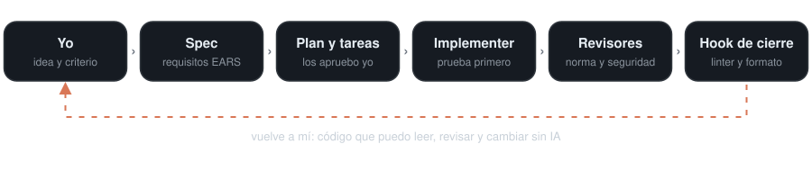

<p align="center">
  
</p>

## Quién soy

Pasé diez años soldando en talleres del metal. Hoy trabajo como **software developer**: mantengo y escalo una web en producción y desarrollo desde cero un asistente telefónico y un chatbot que atienden a clientes reales.

Me gusta el código que se entiende a la primera, también el que escribe la IA.

---

## Proyectos reales

### [toolsequip.es](https://toolsequip.es) · mantenimiento y escalado

Mantengo la web y la hago crecer:

- **Área de cliente**, para que cada cliente siga lo suyo sin tener que llamar.
- **Métodos de pago** integrados en la propia web.
- **Redes sociales** conectadas con la plataforma.

### Asistente telefónico y chatbot · desde cero *(código privado)*

Un asistente virtual atiende el teléfono, toma los pedidos de recambios de los talleres y los deja listos para que una persona revise compatibilidad y stock.

- **Asistente de voz con Vapi:** entiende el pedido, deletrea la matrícula si hay duda y llama a una API propia en FastAPI.
- **Pedidos en PostgreSQL** con numeración segura y sin duplicados aunque Vapi reintente la llamada.
- **Panel interno en React + TypeScript** para revisar, preparar y entregar cada pedido, con resguardo en PDF.
- **Seguridad desde el principio:** webhook protegido con secreto, migraciones versionadas y CI con pruebas contra un PostgreSQL temporal y auditoría de dependencias.
- **En marcha:** chatbot con **Chatwoot** para atender también por escrito.

### [Weldix](https://github.com/fernando-delrio/weldix) · SaaS multi-tenant para talleres del metal · **[→ probar](https://weldix.es)**

Mi proyecto propio más grande, en producción. Pensado desde el lado del operario, no desde el diagrama entidad-relación: órdenes de trabajo con máquina de estados, fichaje con QR desde tablet, stock con alertas, RRHH, mantenimiento de maquinaria, asistente de IA con el contexto del taller (Mistral) y avisos por WhatsApp con n8n.

`React 19` `Vite` `Tailwind v4` `FastAPI` `SQLAlchemy` `PostgreSQL` `Stripe` `n8n` · aislamiento por `tenant_id` y capas router → service → model.

> En el plan gratuito de Render: el primer inicio de sesión puede tardar hasta un minuto.

---

## Cómo trabajo con IA

Uso agentes de IA para programar, pero el código tiene que poder leerlo y cambiarlo yo sin ayuda. Para eso tengo montado un **arnés propio sobre Claude Code**:

<p align="center">
  
</p>

- **Spec antes que código:** cada funcionalidad empieza por requisitos, plan y tareas que apruebo yo antes de que se toque una línea.
- **Un agente implementa una sola tarea**, con la prueba primero, y nunca hace commit: eso lo hago yo.
- **Agentes revisores:** uno comprueba mi norma de estilo, otro el oficio (SOLID, Clean Code, Ousterhout, McConnell) y otro la seguridad del backend (OWASP).
- **Hook de cierre:** al terminar, pasa formateador, linter y la prueba de la norma solo a las líneas cambiadas, y devuelve los fallos al agente para que los corrija.
- **Mi norma de estilo**, en un plugin propio: funciones cortas, guardas en lugar de `else`, tablas en lugar de cadenas de `if`, sin ternarios, nombres con sentido y errores en un solo sitio.

Así escribo, y así tiene que escribir la IA:

```ts
const SIGUIENTE_ESTADO = {
  pendiente: 'en_proceso',
  en_proceso: 'listo',
  listo: 'entregado',
  entregado: 'entregado',
} as const

export const avanzarPedido = (pedido: Pedido) => {
  if (pedido.isAnulado) return pedido
  return { ...pedido, estado: SIGUIENTE_ESTADO[pedido.estado] }
}
```

---

## Stack

**Frontend**


**Backend y datos**


**IA, voz y automatización**


**Calidad y CI**


**Infraestructura y pagos**


---

## Hablamos

Si quieres hablar de agentes de IA, de código que se pueda leer o de un proyecto, escríbeme. El Bierzo (León) o remoto.

<p align="center">
  <a href="https://www.linkedin.com/in/fernando-david-del-rio-96b71168/">
    
  </a>
  <a href="mailto:fernandogondelrio@gmail.com">
    
  </a>
</p>

<sub>Las imágenes animadas se generan con <code>npm run imagenes</code> (<a href="./scripts/">scripts/</a>), con logos de <a href="https://simpleicons.org">Simple Icons</a>.</sub>
